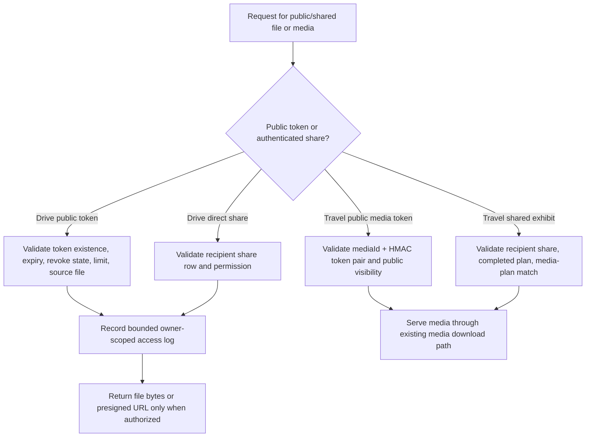

# Public Share Authorization Contract

Updated: 2026-10-16

This contract records the release boundary for public and shared file/media access in TravelLedger. It complements `docs/drive_share_permissions.md` by covering both CalenDrive direct shares, public download links, travel public media tokens, shared travel exhibits, and privacy revocation controls.

## Scope

| Surface | Entry point | Authorization boundary |
| --- | --- | --- |
| CalenDrive public download link | `/api/file/public-download/{token}` and public presigned download resolution | Link must exist, not be revoked, not be expired, under download limit, attached to a valid non-trashed file, and access must be logged without raw-token storage. |
| CalenDrive direct share | `/api/file/share/shared/{fileId}/download`, `/api/file/share/{fileId}/access-logs` | Recipient must have an explicit share row; `VIEW` cannot download or save; owner alone can read direct-share access logs. |
| CalenDrive share permission | `DriveSharePermission.VIEW`, `DOWNLOAD`, `EDIT` | Omitted permissions default to `DOWNLOAD`; unknown values fail fast; `EDIT` is reserved but still download-capable until collaborative edit semantics exist. |
| Travel public media token | `/api/travel/public/media/{mediaId}/content?token=...` | Token must match the requested media id using the configured public-media secret and the media must still be public/community-visible; rotating `app.security.public-media-key` revokes previously issued stateless URLs. |
| Travel shared exhibit media | `/api/travel/shared-exhibits/{shareId}/media/{mediaId}/content` | Authenticated recipient must own the share row, the source plan must be completed, and media must belong to that shared plan. |
| Authenticated Travel atlas | `/api/travel/public-trips` and cluster child | Active viewer sees published COMPLETED plans first, then directly received COMPLETED plans without duplicates. Public photos use existing pair-bound HMAC URLs; private received photos use their recipient share URL. No owned-summary cache is an authorization source. |
| Travel community feed | `/api/travel/community-feed` | Active viewer sees community-shared MEMORY records with a PHOTO. Unlike atlas, completed/public plan status and coordinates are not required. SQL page totals are retained after in-page presentation filtering; author is the chosen photo uploader. |
| Travel bearer map link | `/api/travel/public/map-shares/{token}`, cluster and media children | Link must currently be active; selected plans must still belong to the link owner; excluded records/media/routes are applied per request. Media must be a MEMORY PHOTO with record or GPS coordinates. This is not completed/public/community publication. |
| Login map preview | `/api/travel/public/login-map-preview` and numbered thumbnails | Enabled settings point to an active bearer map link. Preview strips names/ids/tokens, rounds coordinates, bounds markers/routes and proxies thumbnail-only no-store bytes; disabled/revoked settings fail closed. |
| Privacy revocation | `/api/privacy/public-download-links`, `/api/privacy/travel-public-media-shares`, `/api/privacy/cleanup` | Authenticated user with CSRF can revoke only their own Drive public links and Travel public/community media share surfaces. |

## Authorization flow

Atlas/feed extraction (2026-10-16): `ReadTravelAtlasUseCase`, `TravelAtlasController` and `JpaTravelAtlasAdapter` keep all three GET paths and readonly/mandatory boundaries. `TravelAtlasPolicy` preserves published-first insertion order and first-recipient-share precedence. Every request checks the viewer and current DB scope; there was no atlas summary-cache read to migrate. HMAC issuance delegates to the unchanged token service, while HTTP URL composition remains in the inbound mapper. Direct share deletion, publication/completion changes and current media authorization are rechecked on subsequent server requests.

Atlas overview/cluster/plan metadata keep counts without coordinates, GPS fallback, photo-only filtering, representative-coordinate cluster headers (not centroid), focus sorting, 36-item cluster page cap and full GPX resolution/defaults. Community has a separate 10-default/20-max page size, preserves SQL totals and chooses the newest photo uploader rather than the plan owner. A frozen 29-method earlier implementation is independently compared across 48 generated public/private/duplicate-share scopes. H2/MockMvc verifies anonymous rejection, duplicate public precedence, recipient-only bytes, state changes, community SQL totals, GPX and transaction boundaries. Generic thumbnail browser caching/fallback and the HMAC algorithm/key configuration are unchanged.

Bearer map-link extraction (2026-10-16): `TravelMapLinksUseCase`/`TravelMapLinkController` own creation and anonymous map/cluster/media reads through `JpaTravelMapLinkAdapter`. Creation validates an active creator, every selected owned plan and every exclusion before saving one link in the same write transaction. Existing 24-byte SecureRandom, URL-safe unpadded tokens and collision checks are unchanged. Reads re-evaluate active link/current owner-plan scope without an owner map cache; existing links do not gain an expiry, completed/public-plan requirement or active-owner-login requirement. Missing/transferred plans disappear from the overview but original selected ids remain in the link metadata. Legacy fail-soft stored-scope JSON decoding is preserved, not newly hardened.

Login preview settings now depend on the map-link use case instead of TravelService. The same marker/route limits, coordinate rounding and endpoint sampling are retained; after rounding, a 320-point route can still yield 161 samples because the endpoint is retained. Overview routes decode only the stored path; login preview still resolves original GPX with the existing fallback. Server authorization does not change generic public-thumbnail browser caching/original fallback. Existing HMAC media, recipient exhibits, group acceptance and database schema are separate contracts. The earlier workflow is frozen in `TravelMapLinkLegacyOracle` and compared across 48 generated scopes; H2/MockMvc covers current ownership, revocation, exclusions, anonymous reads, no-store login thumbnails and write/readonly/mandatory boundaries.

Exhibit read extraction (2026-10-16): `ReadTravelExhibitsUseCase` and `TravelExhibitController` connect received exhibits and pair-bound public media through a MANDATORY read adapter. Existing HMAC validation is unchanged: token-first, then current visibility; recipient/completed-plan/media-plan rules still apply and never use the owned-media cache for authorization. Approved record-group bridges remain internal and run only after RecordSharingService's current acceptance/group authorization. H2/MockMvc tests cover pending/accepted/canceled/group-removed access and private/no-store record-share thumbnails; detached detail JSON is compared against a frozen earlier DTO assembler over 150 generated data shapes. The initial approval-review quota interruption was resolved through the same approval path after its retry time. Full isolated backend regression and WAR verification passed; evidence is recorded in docs/backend_refactoring_progress.md, not a claim of operating MariaDB/MinIO or external CI verification. Server-side revocation checks do not change the existing generic thumbnail browser-cache/fallback policy.

Travel sharing management now enters through `TravelSharingController` and `ManageTravelSharingUseCase`. The pure workflow checks active-account/plan-owner/completed-plan/recipient rules in the same operation-specific order as before. `JpaTravelSharingAdapter` requires the caller transaction; owner/name group replacement validates every recipient first, then deletes and flushes old memberships before inserting the de-duplicated replacements. Existing unique constraints, query ordering and timestamp behavior are unchanged. Repeated plan sharing reuses the existing row; it does not add application locking or retry on a concurrent unique-key conflict.

Management is distinct from read authorization: recipient exhibit/media reads, HMAC token checks, completed-plan visibility and media-plan matching remain in the existing read paths. Cancelling a share removes its row so the recipient can no longer read that exhibit. Public-toggle cache invalidation still runs immediately and after commit, including the existing separate public-key eviction in addition to owner-summary eviction. Group changes still do not invalidate travel summary caches. H2/MockMvc rollback, owner scope, validation and unchanged JSON are covered by `TravelSharingRefactoringIntegrationTest`; pure order and DTO checks run alongside it. This does not prove MariaDB collation/concurrency or production deployment behavior.

## Required invariants

| Invariant | Required behavior |
| --- | --- |
| Public Drive tokens are bounded | Created links must have min/max expiry, max download limit, revocation state, and availability derived from expiry/revocation/download count. |
| Invalid public tokens fail closed | Blank, missing, revoked, expired, over-limit, invalid-item, and trashed-file tokens must not load file bytes or generate presigned URLs. |
| Access logs are safe | Public link and direct-share logs must store owner/item/status metadata and token fingerprints, not raw tokens. User-agent/client address fields stay bounded. |
| Direct share permissions are enforced | `VIEW` shares can list/preview only; download URL generation, object loading, and save-to-drive must require `DOWNLOAD` or `EDIT`. |
| Direct share failures are observable | `not_found`, `unavailable`, `permission_denied`, and `success` direct-share statuses remain bounded and owner-scoped. |
| Access log visibility is owner-only | File owners can inspect public/direct-share access logs; non-owners must be rejected before log reads. |
| Travel public media token is pair-bound | A token issued for one media id must not work for another media id, missing token, blank token, tampered token, or different secret. Rotating `app.security.public-media-key` must invalidate previously issued Travel public media URLs. |
| Travel public media visibility is checked after token match | A valid token is not enough; media must be a public/community-visible photo or belong to a completed public plan. |
| Travel shared exhibit is recipient-bound | Authenticated shared exhibit media requires the recipient share row and the requested media must belong to the shared completed plan. |
| Revocation is current-user scoped | Privacy revocation must revoke only the current user's Drive public links and Travel public/community media surfaces. |

## Implementation anchors

| Area | Evidence to preserve |
| --- | --- |
| Public link creation/revocation | `DriveDownloadLinkService.createLink`, `revokeLink`, `resolveExpiresInMinutes`, `resolveMaxDownloads`, `DEFAULT_EXPIRES_IN_MINUTES`, `MIN_EXPIRES_IN_MINUTES`, `MAX_EXPIRES_IN_MINUTES`, and `DEFAULT_MAX_DOWNLOADS`. |
| Public link access | `DriveDownloadLinkService.downloadByToken`, `resolveDownloadUrlByToken`, `resolveAvailableDownloadLink`, `recordPublicDownloadLinkRequest`, and `recordPublicDownloadLinkAccess`. |
| Public link status coverage | `invalid`, `revoked`, `expired`, `limit_reached`, `invalid_item`, `trashed`, and `success`. |
| Public presigned URL tests | `resolveDownloadUrlByTokenRecordsAccessWithoutLoadingFileBytes` verifies successful public URL resolution logs access without loading raw bytes; `resolveDownloadUrlByTokenRejectsExpiredLinkWithoutGeneratingPresignedUrl` verifies expired public tokens cannot create presigned URLs. |
| Public log safety | `DriveDownloadLinkAccessLogService.record`, `recordDirectShareAccess`, `listRecentLogs`, `listRecentDirectShareLogs`, and token-fingerprint tests. |
| Direct share permission | `DriveShareService.shareFiles`, `normalizePermission`, `effectivePermission`, `ensureDownloadAllowed`, `getSharedFileDownloadUrl`, `downloadSharedFile`, and `listSharedFileAccessLogs`. |
| Direct share tests | `DriveShareServiceTest.shareFilesStoresRequestedViewPermission`, `downloadSharedFileRejectsViewOnlyShareWithoutLoadingObject`, `sharedDownloadUrlRecordsSuccessfulAccess`, `sharedDownloadUrlRecordsViewOnlyDeniedAccess`, `sharedDownloadUrlRecordsMissingRecipientAsNotFoundWithoutGeneratingUrl`, and trashed/unavailable source tests. |
| Travel public token | `TravelPublicMediaTokenService.issueToken`, `matches`, `MessageDigest.isEqual`, `app.security.public-media-key`, and `TravelPublicMediaTokenServiceTest.rotatingPublicMediaKeyRevokesPreviouslyIssuedToken`. |
| Travel public media | `TravelService.getSharedMediaDownload`, `TravelPlanUserScopeIntegrationTest` invalid-token coverage, public memory/community visibility, and completed public plan visibility. |
| Travel shared exhibit | `TravelService.getSharedExhibitMediaDownload`, `getRequiredShare`, completed-plan check, and media-plan match check. |
| Privacy revocation | `PrivacyManagementService.revokePublicDownloadLinks`, `revokeTravelPublicMediaSurfaces`, `PrivacyManagementServiceTest`, and `PrivacyControllerIntegrationTest` auth/CSRF coverage. |

## Release gate

The `public-share-authorization-contract` CI job must pass before promoting changes that affect Drive public links, direct Drive share permissions, public-link access logs, presigned download URL resolution, Travel public media URLs, Travel shared exhibits, privacy revocation, or data-export surfaces that mention shared files or media.

A release is not ready if any of these are true:

| Failure | Why it blocks release |
| --- | --- |
| Public token failure path loads file bytes or creates a presigned download URL. | Allows probing or unauthorized file access. |
| Raw token is stored in access logs. | Converts logs into bearer-secret storage. |
| Non-owner can read a public/direct-share access log. | Leaks forensic history across users. |
| `VIEW` direct share can download, save, or generate a presigned URL. | Breaks the permission model promised to owners. |
| Travel media token works across media ids or secrets, or key rotation fails to revoke old URLs. | Makes public URLs transferable beyond the intended media object or impossible to revoke during incident response. |
| Valid Travel token bypasses public/community/completed-plan visibility. | Exposes private trip media. |
| Privacy revocation updates another user's public links or travel share surfaces. | Breaks account isolation. |

## CI contract

`scripts/verify-public-share-authorization-contract.ps1` keeps this document synchronized with Drive public link services, direct share services, Travel public media token checks, privacy revocation tests, `docs/drive_share_permissions.md`, `docs/security_baseline_checklist.md`, `docs/project_improvement_roadmap.md`, and the GitHub Actions `public-share-authorization-contract` release-gate job.

## Next slices

| Slice | Notes |
| --- | --- |
| Frontend access log view | Surface owner-only Drive public/direct-share access logs without raw tokens. |
| Public media expiry | Add optional expiration/revocation for Travel public media tokens or public plan media URLs; until then, `app.security.public-media-key` rotation is the emergency revocation path. |
| Token rotation runbook | Changing `app.security.public-media-key` invalidates existing Travel public media URLs because tokens are HMACs over media id plus the configured secret; rotate during incident response, redeploy all app nodes with the same new key, and ask owners to regenerate public/community links as needed. |
| Abuse controls | Add rate limiting and alerting for repeated invalid public tokens by bounded fingerprint/status. |
| Share metadata hardening | Keep stored share metadata free of raw tokens and presigned URLs. |

## Test backlog

- Drive public token invalid/revoked/expired/limit/trashed/invalid-item paths never load object bytes or generate presigned URLs.
- Drive public token presigned URL success logs access without reading bytes.
- Drive public access logs store fingerprints and bounded metadata only.
- Direct share `VIEW` cannot download, save, or generate presigned URLs.
- Direct share failures write owner-scoped bounded statuses, including missing-recipient `not_found` attempts before any presigned URL generation.
- Only file owners can list public/direct-share access logs.
- Travel public media token rejects null, blank, tampered, wrong-media, and wrong-secret tokens, and key rotation rejects previously issued URLs.
- Travel shared exhibit media rejects non-recipient, non-completed plan, and wrong-plan media ids.
- Privacy revocation endpoints require auth/CSRF and remain current-user scoped.
